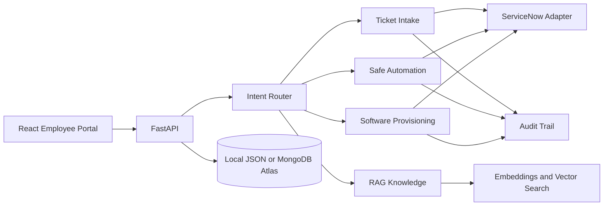

# Sorim.AI — AI-Powered ITSM Helpdesk

A runnable hackathon prototype covering intelligent ticket intake, safe self-healing simulations, RAG knowledge search, employee chatbot routing, software provisioning, mock ServiceNow, and audit logging.

**Honest status:** default mode uses local JSON storage, deterministic offline classification/embeddings, and mock ServiceNow. These defaults work without cloud credentials. Optional Hugging Face, MongoDB Atlas, Sentence Transformers, and real ServiceNow integrations need configuration and separate validation.

## Architecture



## Windows quick start

Open PowerShell in the project root:

```powershell
Copy-Item .env.example .env
py -3.12 -m venv .venv
.\.venv\Scripts\Activate.ps1
python -m pip install --upgrade pip
pip install -r backend\requirements.txt
python -m backend.app.scripts.seed
uvicorn backend.app.main:app --reload
```

In a second terminal:

```powershell
cd frontend
npm install
npm run dev
```

Open `http://localhost:5173`; API docs: `http://127.0.0.1:8000/docs`.

If Python 3.11 is not installed, use a compatible installed Python version. macOS/Linux: `python3 -m venv .venv`, activate with `source .venv/bin/activate`, then run the same pip/uvicorn commands.

## Configuration

- `STORAGE_MODE=local` uses JSON files in `backend/data`. `STORAGE_MODE=mongodb` requires `MONGODB_URI`, `MONGODB_DATABASE`, and `pymongo`.
- `SERVICENOW_MODE=mock` creates clearly labeled mock records. `real` uses the ServiceNow Table API and requires URL, username, password, appropriate ACLs, and instance-specific field validation.
- `AI_PROVIDER=offline` uses deterministic rule-based classification. `huggingface` enables optional Hugging Face chat completions when token and provider access are available.
- `EMBEDDING_MODE=offline` uses deterministic feature-hash vectors for a network-independent demo, not transformer-quality semantic embeddings. Set `sentence-transformers` and install that optional package for actual transformer embeddings.
- `RAG_RELEVANCE_THRESHOLD` controls minimum retrieval similarity. `AI_CONFIDENCE_THRESHOLD` controls escalation recommendation.

Never commit `.env` or place credentials in frontend variables.

## Tests

From project root:

```bash
pytest backend/tests -q
```

Tests use local/mock services and do not prove that external credentials work.

## Required demo scenarios

1. VPN authentication failure → classification → knowledge retrieval → incident → mock ServiceNow reference.
2. Expired password → approved article → authorization/approval → simulated action → validation → audit.
3. Outlook synchronization → RAG response with source article.
4. Visual Studio Code → software request → mock request reference → simulated provisioning status.
5. Unsupported confidential-secret request → refusal and escalation recommendation.

## Known limitations

Local JSON persistence is intended for a single-user demo. Offline hashed embeddings are not a replacement for transformer embeddings. Offline classification is deterministic rules, not live LLM reasoning. A mock ServiceNow reference is not a real ServiceNow record. Real integration behavior depends on instance schema, ACLs, and catalog configuration. Authentication/RBAC and production hardening are out of scope.
